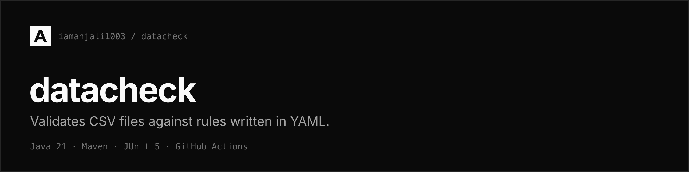

A command-line tool that validates a CSV file against rules written in YAML, and
reports every check that failed.

## Overview

```bash
datacheck examples/signals.csv --spec examples/rules.yaml
```

```
datacheck signals.csv

FAIL  rotor_speed / range
        row 3: 31.4 outside [0.0, 22.5]
FAIL  rotor_speed / notNull
        row 4: empty
ok    power_kw / range

2 check(s) failed
```

The exit code says whether the data passed, so it can stop a build:

| Exit code | Meaning |
| --- | --- |
| 0 | every check passed |
| 1 | at least one check failed |
| 2 | the tool could not run: a file is missing or unreadable, or the report format is not recognised |

## Features

- Five rules: `range`, `notNull`, `unique`, `matches` and `monotonic`
- Four report formats: text, JSON, HTML and LaTeX
- Rules and formats are plugins, found at runtime, so adding one changes nothing that exists
- A bad cell is reported with its row number instead of stopping the run

## Tech stack

| Area | Choice |
| --- | --- |
| Language | Java 21 |
| Build | Maven, with the Shade plugin for a single runnable jar |
| Command line | Picocli |
| Spec parsing | Jackson YAML |
| Tests | JUnit 5, AssertJ |
| CI | GitHub Actions |

## Getting started

Needs JDK 21 and Maven.

```bash
mvn verify          # compile and run the tests
mvn package         # also builds target/datacheck.jar
java -jar target/datacheck.jar examples/signals.csv --spec examples/rules.yaml
```

## Writing a spec

A spec lists columns, and under each column the rules to apply:

```yaml
columns:
  rotor_speed:
    range:
      min: 0
      max: 22.5
    notNull: {}
  power_kw:
    range:
      min: 0
      max: 2500
```

Rules that need no configuration take an empty map.

| Rule | Options | Checks |
| --- | --- | --- |
| `range` | `min`, `max` | every numeric value falls within the range |
| `notNull` | none | no cell is empty |
| `unique` | none | no value appears twice |
| `matches` | `pattern` | every value matches a regular expression |
| `monotonic` | `direction` | numeric values only move one way (`increasing` by default) |

Empty cells are skipped by every rule except `notNull`, so a missing value is
reported once rather than by each rule in turn.

## Output formats

```bash
datacheck data.csv --spec rules.yaml --report json
```

| Format | Use |
| --- | --- |
| `text` | reading in a terminal (default) |
| `json` | passing to another tool |
| `html` | sharing a page with someone |
| `latex` | dropping into a written report |

`latex` writes the `.tex` source. Run it through `pdflatex` for a PDF:

```bash
datacheck data.csv --spec rules.yaml --report latex > report.tex
pdflatex report.tex
```

## How it works

```
   data.csv                rules.yaml
       |                        |
       v                        v
   +---------+            +---------+
   | Dataset |            |  Spec   |
   +---------+            +---------+
        \                     /
         \                   /
          v                 v
          +-----------------+
          |     Engine      |
          +-----------------+
                   |
                   |  looks each rule up by the name
                   |  used in the spec (ServiceLoader)
                   v
   +-------+---------+--------+---------+-----------+
   | range | notNull | unique | matches | monotonic |
   +-------+---------+--------+---------+-----------+
                   |
                   |  one RuleResult per column and rule
                   v
             +-----------+
             |  Report   |
             +-----------+
                   |
                   |  Reporter, also found by ServiceLoader
                   v
      +------+------+------+-------+
      | text | json | html | latex |
      +------+------+------+-------+
```

Two interfaces carry the design. `Rule` is a check that can run against a
column. `Reporter` turns the resulting `Report` into one output format.

Both are found at runtime through `ServiceLoader`, listed in
`src/main/resources/META-INF/services/`. The engine never names a concrete rule
and never names a concrete format, so adding either one means adding a class and
a line to a service file. Nothing existing has to change.

Values stay as strings until a rule reads them. A rule that cares about numbers
parses them itself and reports the rows that would not parse, which keeps a bad
cell from stopping the whole run.

## Adding a rule

1. Implement `Rule` in `rules/`, returning the name the spec will use.
2. Add the class name to
   `src/main/resources/META-INF/services/io.github.iamanjali1003.datacheck.core.Rule`.
3. Add a test in `src/test/java/.../rules/`.

Adding an output format is the same, against `Reporter`.

## Project structure

```
src/main/java/io/github/iamanjali1003/datacheck/
├── Cli.java           entry point, argument parsing
├── core/
│   ├── Dataset.java   a CSV loaded into columns of strings
│   ├── Spec.java      the YAML file, parsed
│   ├── Rule.java      the interface every rule implements
│   ├── Engine.java    applies the spec's rules to the dataset
│   ├── RuleResult.java
│   └── Report.java
├── rules/             one class per rule
└── report/            one class per output format
```

## License

[MIT](LICENSE) © 2026 [Anjali](https://iamanjali1003.github.io)
